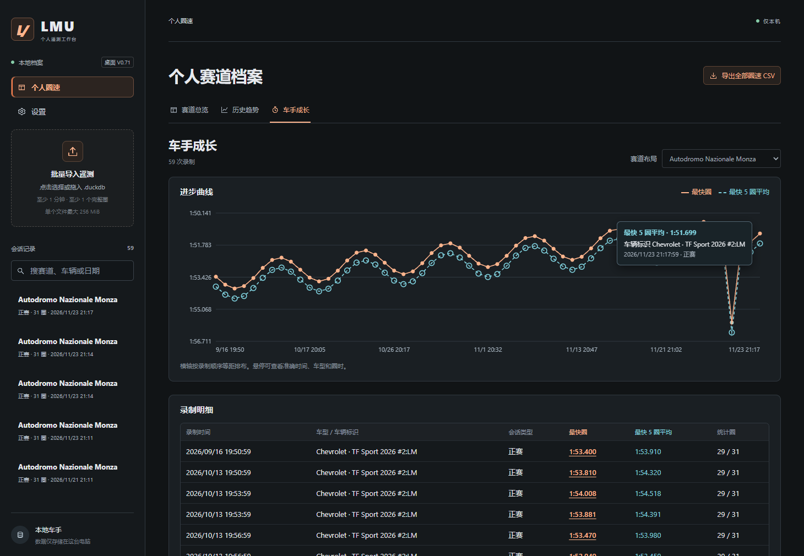

# LMU Data Analysis

> **This project was generated entirely by AI.**

**English** · [简体中文](README.zh-CN.md)

An open-source telemetry analyzer for **Le Mans Ultimate (LMU)** on Windows. Import native DuckDB recordings to compare racing laps and stints, inspect driving inputs, and track your lap times across sessions. The archive stays on your computer.

[Download V0.71](https://github.com/Saturday-365/LMU_Data_Analysis/releases/tag/v0.71) · [Quick start](#quick-start) · [Troubleshooting](#troubleshooting) · [Report an issue](https://github.com/Saturday-365/LMU_Data_Analysis/issues) · [GPL-3.0](LICENSE)



*V0.71 screenshot with simulated data. The desktop interface is currently in Simplified Chinese. The steps below include the button labels shown in the app.*

## Quick start

1. Use a 64-bit Windows PC with [Microsoft Edge WebView2 Runtime](https://developer.microsoft.com/microsoft-edge/webview2/).
2. Download `LMU-Data-Analysis-v0.71-win-x64.zip` from the release assets. Extract the entire archive, then run `LMU-Data-Analysis-v0.71.exe` with the `_internal/` folder beside it. [V0.71 release](https://github.com/Saturday-365/LMU_Data_Analysis/releases/tag/v0.71)
3. Enable native telemetry recording in LMU and wait for the game to finish writing the file. Drop one or more `.duckdb` files onto **Import telemetry** (批量导入遥测). Each file may be up to 256 MiB and must contain at least 60 seconds of recording and one complete lap. [Official LMU telemetry guide](https://guide.lemansultimate.com/hc/en-gb/articles/14524956311695-Telemetry-Recording)
4. Select a recording on the home page and click **Open session** (打开会话). For progress across sessions, open **Lap Archive → Driver Progress** (个人圈速 → 车手成长).

To import automatically at launch, select the game's telemetry directory in **Settings** (设置) and save it. Use **Scan now** (立即扫描) to check for new files while the app is open.

## Features

| Feature | What you can do |
| --- | --- |
| Track archive | Browse sessions by track layout, preview stint pace and lap-time distributions, and export your complete laps to CSV. |
| Driver progress | Plot the fastest lap and mean of the five fastest laps per session. Recordings are ordered by time and evenly spaced. Hover for the car and exact date and time. |
| Lap comparison | Overlay speed, brake, throttle, steering, gear, and available GPS traces. Align laps by distance or elapsed lap time and mark an interval for closer inspection. |
| Session analysis | Explore sector times, theoretical best lap, pit visits, stint pace, and available setup information. |

Driver Progress uses complete timed laps with no known pit-lane activity. Sessions with fewer than five qualifying laps still show their fastest lap. The available telemetry channels determine whether GPS, distance alignment, or sector times can be shown.

## Troubleshooting

| Issue | What to check |
| --- | --- |
| The desktop window does not open | Verify WebView2 is installed and that the ZIP was fully extracted. Close other app windows using the same archive. See `desktop.log` in the archive directory for details. |
| Import was skipped or rejected | Check the file size, duration, and number of complete laps. Files with identical contents are detected as duplicates. Wait for the game to finish writing before retrying. |
| I need to upgrade or move to a new PC | Close the app and back up the entire archive folder, including `catalog.sqlite3` and `recordings/`. The default location is `%LOCALAPPDATA%\LMU Data Analysis`. Extract the new version into a separate folder. If you used `--data-dir`, keep using that path. On another PC, copy the backup before launch and update the telemetry folder in Settings. |

Please report the app, LMU, and Windows versions along with steps to reproduce and the expected and actual behavior. Remove personal information from any screenshots or logs you share. [Issue templates](https://github.com/Saturday-365/LMU_Data_Analysis/issues/new/choose)

## Run from source

Use Git and Python 3.12 on Windows. These commands run the desktop app from the V0.71 source.

```powershell
git clone https://github.com/Saturday-365/LMU_Data_Analysis.git
Set-Location LMU_Data_Analysis
git checkout v0.71
py -3.12 -m venv .venv
.\.venv\Scripts\python.exe -m pip install -r requirements-desktop.txt
.\.venv\Scripts\python.exe scripts/desktop_app.py
```

Run `.\scripts\build-desktop.ps1` to build the distributable app directory. The project also provides a local web interface and a telemetry reader CLI.

## Documentation

- [V0.71 release notes in English and Chinese](docs/release-v0.71.md)
- [桌面用户指南 · Desktop user guide in Chinese](docs/desktop-v0.71.md)
- [网页端 · Local web interface in Chinese](docs/web-usage.md) · [遥测读取 · CLI in Chinese](docs/reader-usage.md)
- [架构 · Architecture](docs/architecture.md) · [协作 · Contributing](CONTRIBUTING.md) · [测试 · Tests](tests/README.md)

## License

The project is licensed under the GNU General Public License, version 3 only (GPL-3.0-only). Third-party components keep their respective licenses. [Project license](LICENSE) · [Third-party notices](docs/third-party-notices.md)
