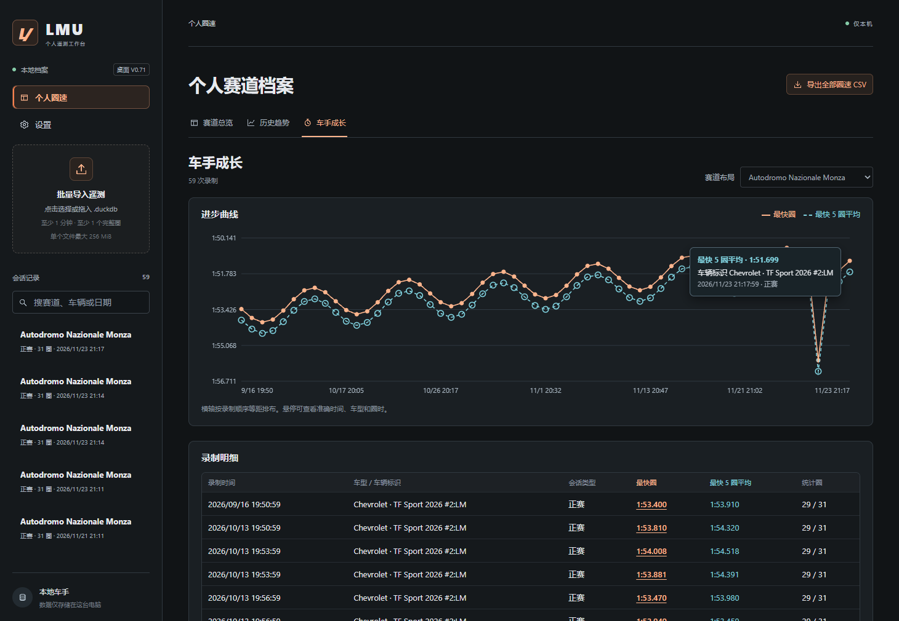

# LMU Data Analysis

> **本项目完全由 AI 生成。**

[English](README.md) · **简体中文**

面向 Le Mans Ultimate（LMU）车手的本地遥测工作台。导入游戏录制的 `.duckdb` 文件，回看驾驶曲线、比较单圈和长距离节奏，并跟踪自己在各赛道的圈速变化。

[下载 V0.71](https://github.com/Saturday-365/LMU_Data_Analysis/releases/tag/v0.71) · [快速开始](#快速开始) · [用户指南](docs/desktop-v0.71.md) · [反馈问题](https://github.com/Saturday-365/LMU_Data_Analysis/issues) · [GPL-3.0](LICENSE)



*V0.71 界面示例使用模拟数据。*

## 快速开始

1. 准备 64 位 Windows 和 [Microsoft Edge WebView2 Runtime](https://developer.microsoft.com/microsoft-edge/webview2/)。
2. 在 [GitHub Releases](https://github.com/Saturday-365/LMU_Data_Analysis/releases) 的 Assets 中下载 `LMU-Data-Analysis-v0.71-win-x64.zip`。完整解压后，运行 `LMU-Data-Analysis-v0.71.exe`，保留同目录的 `_internal/`。
3. 在 LMU 中启用原生遥测录制，跑完后将 `.duckdb` 文件拖到「批量导入遥测」。录制设置和文件位置见 [LMU 官方遥测指南](https://guide.lemansultimate.com/hc/en-gb/articles/14524956311695-Telemetry-Recording)。
4. 在首页选择一场录制并点击「打开会话」。长期积累的数据可在「个人圈速 → 车手成长」查看。

桌面版使用本机档案，默认路径为 `%LOCALAPPDATA%\LMU Data Analysis`。升级前退出旧版，完整解压新版到独立目录再运行。现有档案可直接读取。[备份与换机步骤](docs/desktop-v0.71.md#备份升级和换机)

## 能做什么

| 功能 | 内容 |
| --- | --- |
| 赛道档案 | 按赛道布局汇总完整圈、圈速和节奏。首页预览所选录制的驾驶段和分布图，可导出圈速 CSV。 |
| 车手成长 | 同一布局的各场录制按时间排序并等距排布。对照每场最快圈和最快 5 圈平均，悬停查看车型与准确时间。 |
| 单圈对比 | 叠加速度、刹车、油门、转向、挡位和可用的 GPS 走线，按距离或圈内时间定位并标记区间。 |
| 会话分析 | 查看分段、理论最快圈、进出站、驾驶段圈速分布，以及有记录的调教信息。 |
| 自动导入 | 在「设置」保存游戏遥测目录后，启动时自动扫描，也可立即扫描。 |

## 文档

- [桌面用户指南和常见问题](docs/desktop-v0.71.md)
- [V0.71 发行说明](docs/release-v0.71.md)
- [本地网页使用说明](docs/web-usage.md) · [遥测读取命令](docs/reader-usage.md)
- [架构](docs/architecture.md) · [数据约定](docs/data-contract.md) · [参考资料](docs/references.md)
- [协作说明](CONTRIBUTING.md) · [测试](tests/README.md)

## 从源码运行

在 Windows 上用 Python 3.12 创建环境。下列命令启动桌面窗口。只运行本地网页时请参阅 [网页端说明](docs/web-usage.md)。

```powershell
git clone https://github.com/Saturday-365/LMU_Data_Analysis.git
Set-Location LMU_Data_Analysis
git checkout v0.71
py -3.12 -m venv .venv
.\.venv\Scripts\python.exe -m pip install -r requirements-desktop.txt
.\.venv\Scripts\python.exe scripts/desktop_app.py
```

运行 `.\scripts\build-desktop.ps1` 可生成目录版 EXE。源码位于 `src/` 和 `web/`，构建与读取入口位于 `scripts/`。提交问题时可附上软件版本、LMU 版本、复现步骤及去除个人信息后的截图。[构建说明](docs/desktop-v0.71.md#从源码构建) · [问题模板](https://github.com/Saturday-365/LMU_Data_Analysis/issues/new/choose)

## 许可

项目自有源码和文档按 GNU GPL 第 3 版发布（GPL-3.0-only）。第三方组件保留各自的许可。[许可证正文](LICENSE) · [第三方声明](docs/third-party-notices.md)
